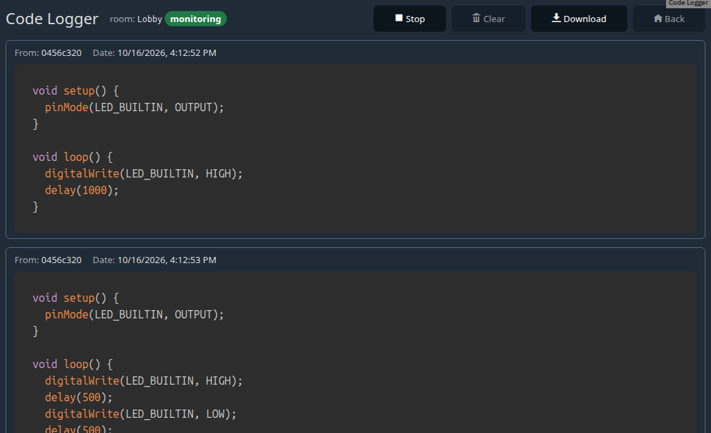

# Edrys Code Logger Module

A teacher's log of the code that is run in a room. While the teacher is monitoring, every message with the
subject `execute` (sent e.g. by the Execute button of
[module-monaco-editor](https://github.com/edrys-labs/module-monaco-editor) or [blockly-duino](https://github.com/edrys-labs/module-blockly-duino-v2)) is listed with its sender and
time, kept in the teacher's browser, and can be downloaded as JSON.



## Usage

Add the module to your class with this URL:

```
https://edrys-labs.github.io/module-code-logger/
```

The module is shown in every room (`show-in: *`), but only **teachers** get the log. Students and stations see a
short note instead. This only hides the controls: any module in a room can receive the messages sent there.

1. Enter the room you want to watch. Messages are delivered per room, so only code run **in the teacher's
   current room** is logged. To log the students at a station, enter the station's room.
2. Click **Start Monitoring**. The header shows the room and the status (`monitoring`). New runs appear as they
   arrive, ten per page.
3. **Stop** ends the log; **Download** saves it as a JSON file; **Clear** empties the view; **Back** returns to the
   start.

Leaving the room or reloading the page stops monitoring. Everything logged so far is kept in the browser and can
be opened again with **Load Logs from DB**, which lists the logs of the current class, newest first. A downloaded
file can be opened with **Load Logs from File**.

## Configuration

Both settings are in the general tab (`config`) of the module in the class settings:

| Field | Default | Meaning |
|-------|---------|---------|
| `runCommand` | `execute` | Message subjects to log, comma-separated. Set it to the `runCommand` of your editors if you changed theirs. |
| `language` | `cpp` | Code highlighting: `cpp`, `c`, `python`, `javascript` or `none`. |

```yaml
config:
  runCommand: execute, run
  language: python
```

## Messages and storage

- **Listens to** the subjects in `runCommand` from every module in the room (`Edrys.onMessage(…, true)`). The body
  is usually the code as text; other values are logged as JSON. A multi-file body `{"file": {"name": "code"}}`
  (module-monaco-editor in multi-file mode) is shown as one block per file.
- **Sends** nothing and keeps **no shared state**: the log exists only in the browser of the teacher who records
  it.
- **Stores** each log in the browser's IndexedDB (database `CodeLogger`, scoped to the module's origin): table
  `logs` with one record per log (`id`, `classId`, `room`, `startedAt`), table `entries` with one record per run.
  Logs saved by earlier versions of the module are still listed, marked "(older format)".

## File format

A downloaded log (`code-log_<room>_<start>.json`) is a JSON array of runs:

```json
[
  {
    "From": "04ab7a70",
    "FromId": "04ab7a70…_…",
    "Date": "10/16/2026, 3:48:15 PM",
    "Code": "void setup() {}"
  }
]
```

`From` is the name edrys shows for the sender, `FromId` the sender's username, `Date` the time in the teacher's
locale. **Load Logs from File** accepts any array whose entries have a `Code` field.

## License

[MIT](LICENSE) © edrys-labs
